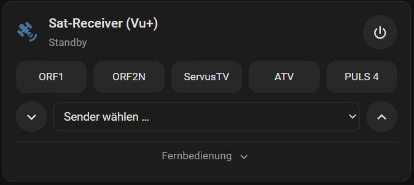

# Sat-Karte

Sat-Receiver (Enigma2/Vu+): laufender Sender, Lieblingssender, Kanal +/- und Senderliste



## Installation

### Über den Marketplace (Home Assistant 2026.11 und neuer)

1. **Einstellungen** → **Marketplace** → **Aus Link hinzufügen**.
2. Die Adresse dieses Repositorys eintragen, Kategorie **Dashboard**.
3. **Sat-Karte** installieren. Die Ressource wird dabei automatisch eingetragen.

### Über HACS (ältere Versionen)

**HACS** → ⋮ → **Benutzerdefinierte Repositories** → Adresse dieses Repositorys, Typ **Dashboard** → installieren.

### Manuell

`sat-karte.js` nach `/config/www/` kopieren und unter **Einstellungen** → **Dashboards** → ⋮ → **Ressourcen**
als JavaScript-Modul `/local/sat-karte.js` eintragen.

## Verwendung

```yaml
type: custom:sat-karte
```

## Konfiguration

```
Sat-Karte: Enigma2-/Vu+-Receiver (Ein/Aus, laufender Sender und Sendung, Lieblingssender als Tasten,
Kanal +/-, Auswahl aller Sender). Optional schaltet sie den Fernseher auf den passenden Eingang.

  type: custom:sat-karte
  entity: media_player.vu_uno_4k
  name: Sat-Receiver                     # optional
  sender: [ORF1 HD, ORF2N HD, ServusTV HD Oesterreich]   # optional, Lieblingssender (Namen wie in der Senderliste)
  tv: media_player.lg_webos_tv_uj675v    # optional, Fernseher
  tv_eingang: HDMI-1                     # optional, Eingang des Fernsehers fuer den Sat-Receiver
  tasten: rest_command.vu_taste          # optional, Fernbedienung zum Aufklappen. Dienst bekommt die Tastennummer als 'code'
                                         # (OpenWebif: http://<receiver>/api/remotecontrol?command={{ code }}).
                                         # Die Fernbedienung erscheint erst, wenn es den Dienst in HA gibt.
```

## Lizenz

MIT
